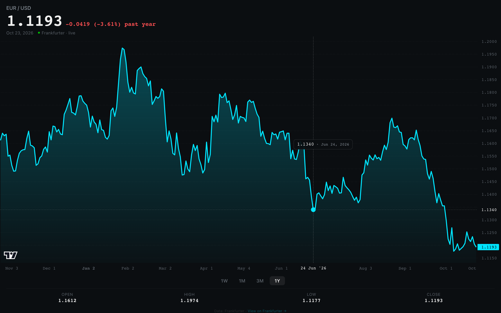
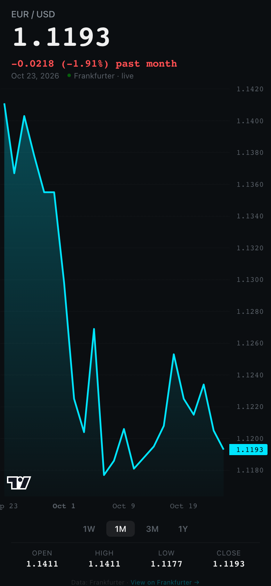

<div align="center">

<h1>eurusd</h1>

<p><b>The euro-dollar rate, as a clean line chart.</b></p>

<p><i>One page, one pair: a year of daily EUR/USD reference rates from the European Central Bank, readable on a phone.</i></p>

<h6>

-00e5ff?style=flat-square)


</h6>

<a href="https://eurusd.parthchandak.info"><b>Live demo</b></a> ·
<a href="#how-it-works"><b>How it works</b></a> ·
<a href="#run-it"><b>Run it</b></a>

<br><br>

<a href="https://eurusd.parthchandak.info"></a>

<sub>Live capture, Oct 23 2026, 1Y view with a tapped readout. Real ECB data.</sub>

</div>

<br>

A dark, brokerage-style chart of EUR/USD. The big number is the latest ECB reference rate; the
coloured line under it is the change over the selected period. Switch between one week, one
month, three months and one year, and tap or hover anywhere on the line to read that day's rate.

## How it works

| Step | What happens |
|---|---|
| Load | Fetches the last 12 months of daily EUR to USD rates from the [Frankfurter](https://frankfurter.dev/) API (ECB reference rates, published on working days). |
| Draw | Plots them as an area series with TradingView Lightweight Charts, 4-decimal price axis. |
| Pick a range | 1W, 1M, 3M or 1Y re-slices the data; the header change and the open, high, low and close row follow the range. |

- **Readout.** Mouse users get a crosshair that follows the pointer; on touch, a tap pins the
  rate and date for that day.
- **Freshness label.** Shows `live` when the newest rate is from today, otherwise how many days old it is.
- **Fallback.** If the API fails or takes over 3 seconds, the page draws a small built-in sample
  from July 2026 and labels it `sample data · API unavailable`.



<sub>Phone layout, 1M view.</sub>

## Run it

There is no build step. Everything is in `index.html`.

```bash
git clone https://github.com/parthchandak02/road.git
cd road
python3 -m http.server 8000   # then open http://localhost:8000
```

Deploy (Cloudflare Pages project `road`, direct upload):

```bash
mkdir -p dist && cp index.html dist/
npx wrangler pages deploy dist --project-name=road --branch=main
```

<details>
<summary>History</summary>

The repo started as "Road", a 3D React Three Fiber scene where EUR/USD drew the elevation of a
night-time mountain road. It was later replaced by this single-file chart. The original brief
is in [`docs/original-brief.md`](docs/original-brief.md) and the 3D code is in the git history.
The site answers on both `eurusd.parthchandak.info` and `road.parthchandak.info`.

</details>

<br>

<div align="center">
<sub>Built with plain HTML and TradingView Lightweight Charts. Data from Frankfurter (European Central Bank).</sub>
</div>
